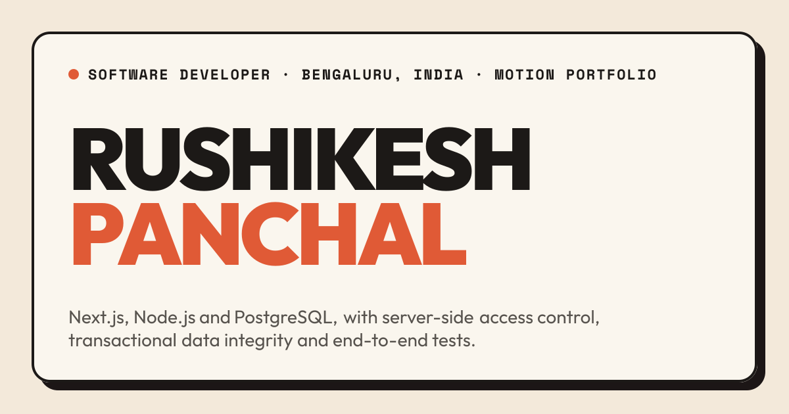
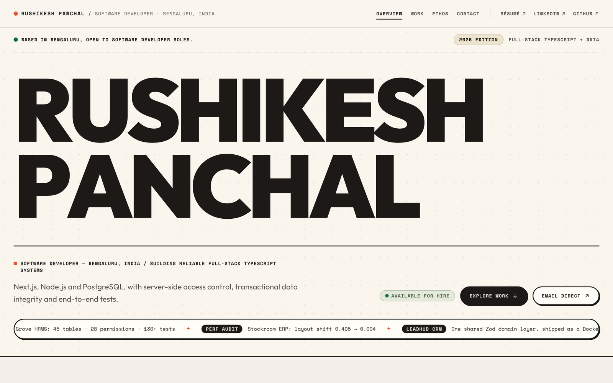
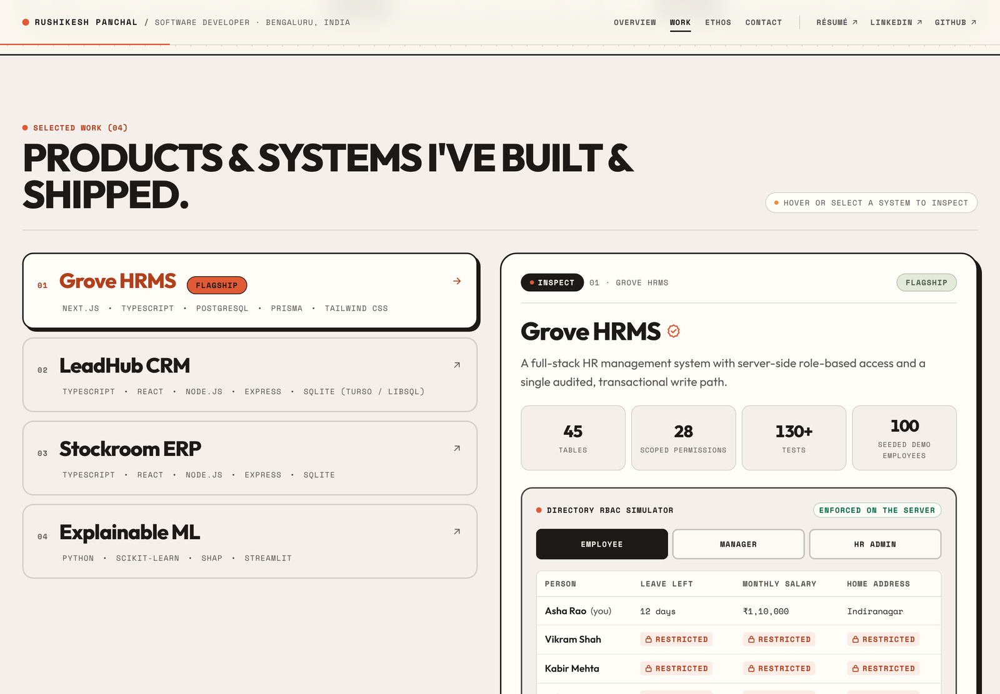
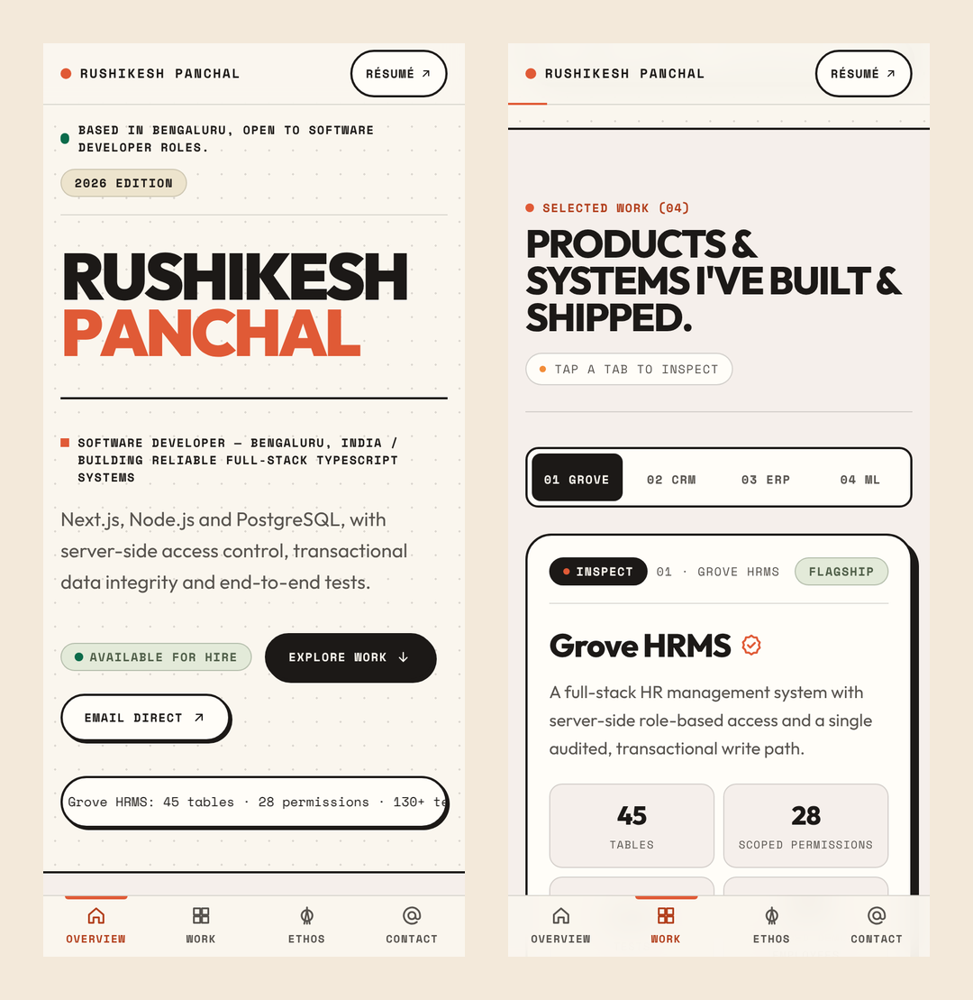
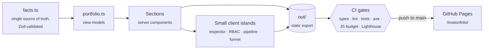

<div align="center">

<a href="https://rrushikeshp89.github.io/motionfolio/">
  
</a>

# Motion Portfolio

**The animated portfolio of Rushikesh Panchal, Software Developer in Bengaluru.**<br />
Warm editorial neo-brutalism, built from Stitch designs, shipped as a fast static site.

[](https://github.com/rrushikeshp89/motionfolio/actions/workflows/ci.yml)
[](https://rrushikeshp89.github.io/motionfolio/)
[](#-quality-gates)
[](#-quality-gates)

[**View the live site →**](https://rrushikeshp89.github.io/motionfolio/) &nbsp;·&nbsp;
[Main portfolio](https://rrushikeshp89.github.io) &nbsp;·&nbsp;
[Design decisions](DECISIONS.md)

</div>

---

## ✦ What's on the page

One page, two layouts: the Stitch **desktop** export drives wide screens and the **mobile**
export drives phones. Every section moves, and none of it needs JavaScript to be read.

| Section                | What it does                                                                                                    |
| ---------------------- | --------------------------------------------------------------------------------------------------------------- |
| **Hero**               | The name rises in letter by letter; a ticker scrolls through recently shipped work.                             |
| **Selected work**      | A work list with a sticky inspector panel (a tab strip on phones), with live demo, source and case-study links. |
| **RBAC simulator**     | Switch between Employee, Manager and HR Admin and watch Grove HRMS hide fields that role can't see.             |
| **How I work**         | Three engineering principles, plus Grove's write path, which traces itself step by step until you pick a step.  |
| **Verified numbers**   | 130+ tests, 45 tables, 0.004 layout shift, each counting up as it scrolls into view.                            |
| **Experience & stack** | Internships, education, skills and certifications.                                                              |
| **Contact**            | Click anywhere and a ping arcs into the funnel counter; copy the email address in one tap.                      |

<p align="center">
  
</p>

<table>
  <tr>
    <td width="62%"></td>
    <td width="38%"></td>
  </tr>
  <tr>
    <td align="center"><sub>Desktop: work list and sticky inspector</sub></td>
    <td align="center"><sub>Phone: hero, project tabs and bottom tab bar</sub></td>
  </tr>
</table>

## ⚡ Quick start

You need **Node 24** (see `.nvmrc`) and **pnpm**.

```bash
pnpm install
```

```bash
pnpm dev
```

Then open **http://localhost:3000/motionfolio/**. The site always lives under its GitHub Pages
base path, including in development.

## 🧰 Scripts

| Command             | What it does                                                                                                                    |
| ------------------- | ------------------------------------------------------------------------------------------------------------------------------- |
| `pnpm dev`          | Development server with hot reload.                                                                                             |
| `pnpm build`        | Static export to `out/`, every URL under `/motionfolio/`.                                                                       |
| `pnpm start`        | Serves `out/` exactly the way GitHub Pages does.                                                                                |
| `pnpm check`        | Typecheck, lint, unit tests and build in one go.                                                                                |
| `pnpm test`         | Unit tests (Vitest).                                                                                                            |
| `pnpm test:e2e`     | End-to-end tests (Playwright) on a 1280px desktop and a 375px phone, including axe accessibility scans. Run `pnpm build` first. |
| `pnpm check:bundle` | Fails if the page ships more than 150 kB of gzipped JavaScript.                                                                 |
| `pnpm lhci`         | Lighthouse mobile audit; HTML reports go to `.lighthouseci/`.                                                                   |
| `pnpm format`       | Prettier, with Tailwind class sorting.                                                                                          |

> [!TIP]
> To run e2e tests or Lighthouse against a Chromium you already have, set
> `PLAYWRIGHT_CHROMIUM_PATH=/path/to/chrome`.

## 🏗️ How it fits together



| Path                       | What lives there                                                                                    |
| -------------------------- | --------------------------------------------------------------------------------------------------- |
| `src/content/facts.ts`     | Every fact on the site, copied from the main portfolio and validated by `schema.ts` at build.       |
| `src/content/portfolio.ts` | View models for this page (ticker, inspector, write path, big numbers), all derived from the facts. |
| `src/styles/tokens.css`    | The palette from Stitch's `DESIGN.md`, with every text/background pair contrast-tested.             |
| `src/app/globals.css`      | Tailwind theme, hard ink shadows, the "keystroke" press, keyframes and scroll reveals.              |
| `src/motion/`              | The animation layer: reveal script, count-up, marquee, hooks and timing tokens.                     |
| `src/components/sections/` | One file per section; interactive parts are small client components.                                |
| `tests/`                   | `unit/` for Vitest, `e2e/` for Playwright.                                                          |

## 🎞️ Motion, without the weight

- **CSS first.** Letter rises, panel and row entrances, cell flips, sliding indicators and
  hover lifts are CSS keyframes and transitions. The header's progress line is a CSS
  scroll-driven animation, with zero JavaScript.
- **Motion's WAAPI `animate`** (`motion/mini`) handles what CSS can't: pings arcing into the
  funnel, and the funnel's little "gulp" when one lands.
- **Content never waits on animation.** Everything is in the server HTML. Reveals only apply
  when an inline script has run, and nothing moves or starts hidden under
  `prefers-reduced-motion`. Tests check both cases, plus a no-JavaScript run.

Moving from Motion's React components to this setup took the page from 194 kB to 147.6 kB of
JavaScript ([ADR-006](DECISIONS.md#motion)).

## ✅ Quality gates

CI runs every gate on every push and pull request. A push to `main` only deploys if all of them
pass.

| Gate                  | Result                                                                            |
| --------------------- | --------------------------------------------------------------------------------- |
| Lighthouse, mobile    | **98** Performance · **100** Accessibility · **100** Best Practices · **100** SEO |
| Core Web Vitals (lab) | LCP **0.91 s** · CLS **0.000**                                                    |
| JavaScript on `/`     | **147.6 kB** gzipped, budget 150 kB                                               |
| Unit tests            | **61**: schema, palette contrast, view models, permissions demo                   |
| End-to-end tests      | **37**: axe, keyboard, RBAC, write path, copy email, reduced motion, no-JS        |
| Third-party requests  | **None**: self-hosted fonts, inline SVG icons, `default-src 'self'` CSP           |

<sub>Lighthouse and bundle figures were measured locally on the build in
[DECISIONS.md](DECISIONS.md#measurements-local-this-build).</sub>

## 📝 The content rule

> [!IMPORTANT]
> Nothing on the page is typed by hand into a component. Every number and claim comes from
> `src/content/facts.ts`.

That file is a copy of the main portfolio's. When your details change there, copy
`src/content/facts.ts` and `schema.ts` across; the build fails if anything is invalid. Claims the
Stitch mock-ups invented were left out, and a unit test stops them from coming back. The full
list is in [DECISIONS.md](DECISIONS.md#content-what-changed-from-the-stitch-mock-ups).

## 🚀 Deploying

1. In the repository, set **Settings → Pages → Build and deployment → Source** to
   **GitHub Actions** (one-time).
2. Merge to `main`. CI runs every gate, then publishes `out/` to
   **https://rrushikeshp89.github.io/motionfolio/**.

To serve from a custom domain or a site root instead, build with an empty base path:

```bash
MOTIONFOLIO_BASE_PATH="" pnpm build
```

## 🛠️ Built with

[Next.js 16](https://nextjs.org) (static export) · [React 19](https://react.dev) ·
TypeScript (strict) · [Tailwind CSS v4](https://tailwindcss.com) · [Zod](https://zod.dev) ·
[Motion](https://motion.dev) · [Vitest](https://vitest.dev) ·
[Playwright](https://playwright.dev) + [axe](https://github.com/dequelabs/axe-core) ·
[Lighthouse](https://developer.chrome.com/docs/lighthouse) · fonts:
[Outfit](https://fonts.google.com/specimen/Outfit) and
[Space Mono](https://fonts.google.com/specimen/Space+Mono), self-hosted from Fontsource.

<div align="center">
<br />

**Rushikesh Panchal** · [GitHub](https://github.com/rrushikeshp89) ·
[LinkedIn](https://www.linkedin.com/in/rushikesh-panchal/) ·
[Main portfolio](https://rrushikeshp89.github.io)

</div>
